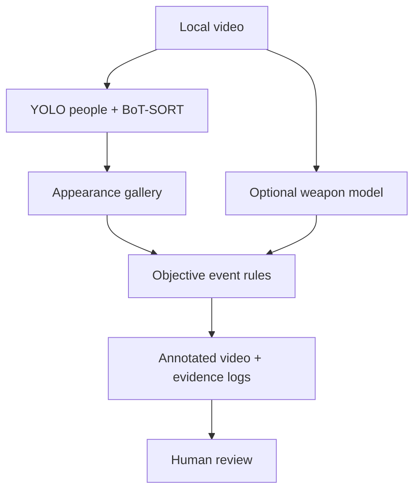

# Architecture

Separation of concerns:

- **Detection** is a model output with a confidence score, not a verified fact.
- **Tracking** connects observations within one clip and can switch IDs.
- **Re-association** proposes an anonymous ID link while the gallery is alive, with conservative ambiguity checks.
- **Event rules** flag observable scene properties; they have no intent classifier.
- **Review** is the operator's responsibility. The UI shows evidence but does not authenticate users or create signed case decisions.

The pipeline never transmits video or embeddings to a remote service. First-time model downloads are a distinct outbound operation initiated by underlying model libraries. `report.json` stores a SHA-256 hash by default; if the footage is sensitive, plan hash retention under your data policy too.

